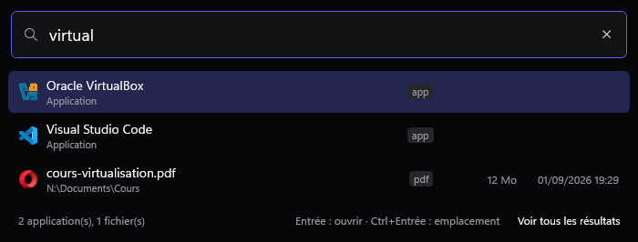
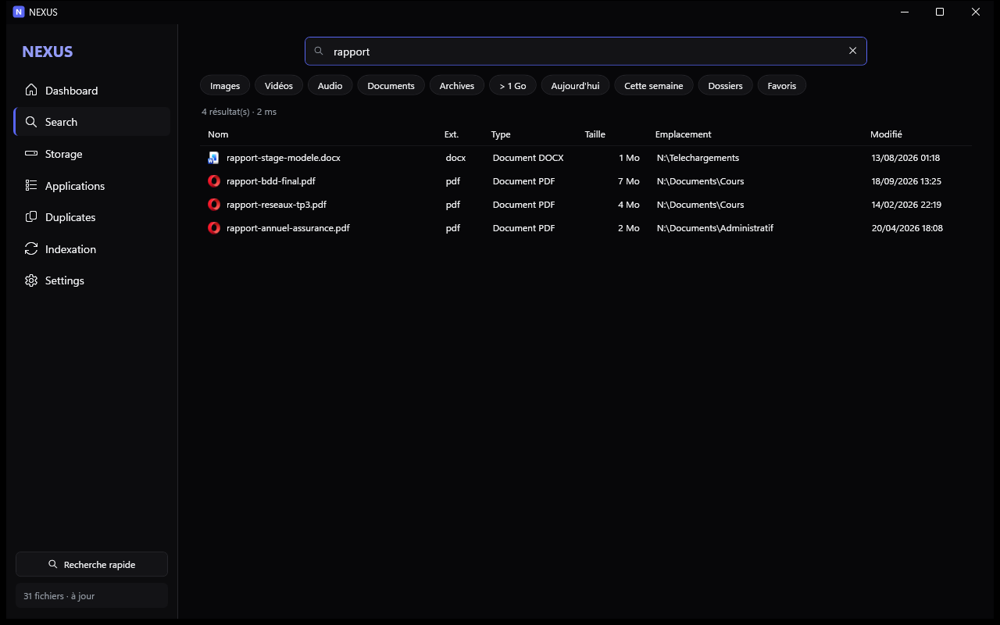
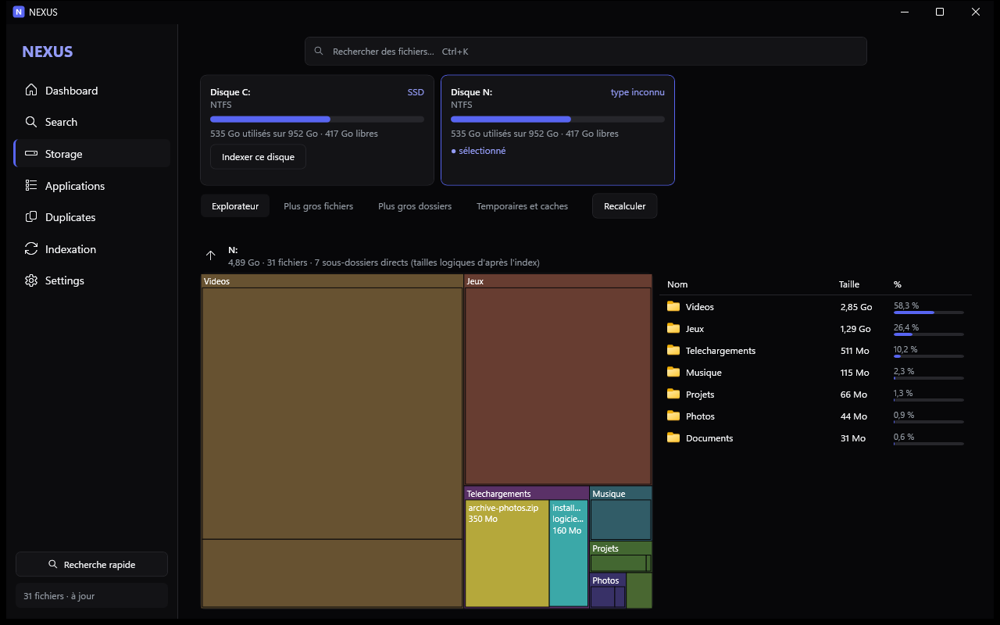
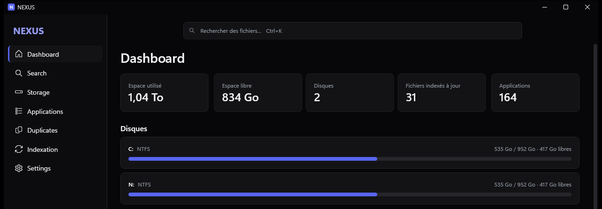

# NEXUS

Gestionnaire de fichiers et de stockage Windows (WPF, .NET 10, x64).

## Aperçu

Captures de l'application réelle, sur un lecteur de démonstration aux fichiers inventés.

**Recherche rapide (Alt+Espace)** : fichiers et applications, depuis n'importe où.



**Recherche** : résultats pendant la frappe sur tout l'index.



**Stockage** : ce qui occupe chaque disque, dossier par dossier.



**Tableau de bord** : l'état des disques et de l'index en un coup d'œil.



## Installer

Téléchargez `NEXUS-Setup-x.y.z.exe` depuis la [dernière Release](https://github.com/obvSoul/nexus/releases/latest), puis lancez-le. L'installateur n'est pas signé : si Windows SmartScreen s'affiche, choisissez **Informations complémentaires**, puis **Exécuter quand même**. Windows 64 bits requis, aucun droit administrateur ni .NET préinstallé n'est nécessaire. Pour mettre à jour, lancez un installateur plus récent : l'index et les réglages sont conservés. L'historique des versions est dans [CHANGELOG.md](CHANGELOG.md). Au premier lancement,
ouvrez **Indexation** et cochez les disques à indexer.

## Widget de recherche

**Alt+Espace** ouvre ou masque une barre de recherche flottante depuis n'importe quelle application, même quand la fenêtre de NEXUS est fermée (NEXUS reste alors dans la zone de notification ; clic droit sur l'icône pour quitter). Elle utilise le moteur et la syntaxe de la page Search. Les applications du menu Démarrer (programmes, Store, jeux Steam et Epic) et les programmes installés sans raccourci apparaissent en tête quand vous tapez un simple nom ; Entrée les lance. Un filtre comme `ext:` ne cherche que des fichiers. Flèches pour choisir, Entrée pour ouvrir, Ctrl+Entrée pour l'emplacement, Échap pour masquer, clic droit pour les autres actions. Réglages dans **Settings > Search Widget** : raccourci, taille de la barre, position, écran, nombre de résultats, dernière recherche, démarrage avec Windows.

## Compiler

SDK .NET 10 et Inno Setup 6 requis :

```powershell
installer\build.ps1            # tests, build Release autonome, installateur dans artifacts\
installer\build.ps1 -Version 1.0.6 -SkipTests
```

Pour publier une mise à jour : changez `Version` dans `Directory.Build.props`, relancez `build.ps1` et distribuez le nouvel installateur.
Il n'y a pas de serveur de mise à jour : NEXUS fonctionne hors ligne et ne vérifie rien sur Internet.

## Architecture (Phase 1)

| Projet | Rôle | Dépend de |
|---|---|---|
| Nexus.Core | Modèles, interfaces, aucune dépendance | - |
| Nexus.Database | SQLite (WAL, FTS5), schéma, migrations | Core |
| Nexus.Infrastructure | API Windows : MFT/USN, registre, FileID, icônes, logs | Core |
| Nexus.Search | Moteur de recherche (index SQLite interne, Everything SDK, Windows Search) | Core, Database, Infrastructure |
| Nexus.Indexer | Scan incrémental, USN Journal, FileSystemWatcher, throttling | Core, Database, Infrastructure |
| Nexus.Storage | Analyse disques/dossiers, données du treemap | idem |
| Nexus.AppAnalyzer | Applications installées et tailles | idem |
| Nexus.Duplicates | Taille -> hash rapide -> SHA-256 | Core, Database |
| Nexus.App | WPF, MVVM (CommunityToolkit.Mvvm), DI | tous |

Décisions : tous les projets ciblent `net10.0-windows` x64 ; `Microsoft.Data.Sqlite` (FTS5 inclus) ;
Everything est optionnel (repli sur l'index interne) ; aucune suppression automatique.

## État

- [x] Phase 1 : solution, projets, références, compilation OK
- [x] Phase 2 : fenêtre principale, thème sombre, navigation latérale (7 pages), barre de recherche
      (Ctrl+K, Échap/bouton pour effacer, Entrée ouvre Search), Dashboard avec les vrais disques (DriveInfo).
      Les 6 autres pages affichent explicitement « non encore implémentée (Phase N) ».
      Mesure (build Debug, démarrage à froid) : fenêtre en ~3,8 s, ~149 Mo de RAM. À réévaluer en Release/ReadyToRun (Phase 8).
      Restent pour plus tard : suggestions, historique et filtres rapides de la barre de recherche (Phase 3).
- [x] Phase 3 : moteur de recherche interne (SQLite + FTS5 trigram), page Search.
      Syntaxe : mots (sous-chaînes, insensible à la casse, `*`/`?`), `"phrase"`, `-exclu`, `*.png`, `ext:`, `type:`,
      `size:>1gb` / `1mb..5mb`, `dm:`/`dc:`/`da:` (today, week, 7d, 2026-01-31, >date, a..b), `path:`, `regex:` ou `/re/`,
      `~mot` (fautes de frappe ; automatique si aucun résultat exact), `is:folder|file|favorite`, `sort:-size`.
      Pagination de 200, chargement au défilement, annulation + debounce 120 ms, historique, suggestions, filtres rapides,
      actions (ouvrir, emplacement, copier chemin/fichier, propriétés, favoris, suppression vers la Corbeille avec confirmation).
      35 tests unitaires. Benchmark (`benchmarks`, 1 M de lignes synthétiques, première page de 200) : 0,3 à 30 ms pour les
      requêtes courantes, 144 ms pour un tri par taille sur 133 k résultats, 338 ms pour une regex (scan complet).
      Limites : le contenu des fichiers, Everything SDK et Windows Search ne sont PAS encore branchés (reportés, voir ci-dessous) ;
      l'insertion en masse est lente (~16 000 lignes/s, FTS + 5 index) : à optimiser en Phase 4/8 ; l'index n'est rempli que
      par l'indexeur (Phase 4) — en attendant, `Nexus.Benchmarks seed <db> <dossier>` + variable `NEXUS_DB` pour essayer.
- [x] Phase 4 : indexeur (`Nexus.Indexer`), page Indexation, Dashboard branché, indicateur dans la barre latérale.
      Un thread dédié (priorité CPU/disque/mémoire basse) fait tout : analyse incrémentale (un dossier dont la date de
      modification n'a pas changé n'est pas relu ; seuls ses sous-dossiers sont visités), surveillance temps réel
      (FileSystemWatcher, changements regroupés après 750 ms de calme, renommages/déplacements conservent l'id et le
      sous-arbre), reprise naturelle après interruption, pause/reprise, ralentissement quand d'autres programmes
      utilisent le CPU, écritures SQLite par lots de 5000, jonctions/liens symboliques indexés mais jamais suivis,
      dossiers protégés exclus ($Recycle.Bin, System Volume Information…), accès refusés comptés et journalisés.
      Sauvegarde de l'index (API de sauvegarde SQLite, au plus 1 par semaine après une analyse + bouton),
      vérification d'intégrité après un arrêt brutal, restauration automatique ou reconstruction ; le fichier abîmé est
      conservé (`.corrupt-…`). Journal technique : `%LOCALAPPDATA%\Nexus\logs\nexus.log`.
      14 tests d'intégration (arbre réel sur disque, watcher, pause, jonction, corruption, migration v1→v2).
      Limites : (1) une modification sur place d'un fichier dans un dossier inchangé n'est vue que par la surveillance
      temps réel ou par « Analyse complète » ; (2) USN Journal NTFS et File ID NON implémentés : ils exigent des droits
      administrateur (lecture du volume) et ne peuvent pas être testés ici sans élévation — le watcher + les dates de
      dossiers couvrent le besoin sans admin ; (3) si le watcher perd des événements (débordement), un rescan
      incrémental est déclenché automatiquement.
- [x] Phase 5 : analyse du stockage (`Nexus.Storage`) + page Storage.
      Tailles de dossiers calculées **depuis l'index** (aucune relecture du disque) en une passe et conservées dans la table
      `dir_stats` ; recalcul automatique seulement si l'index a changé (compteur `index_gen` vs `stats_gen`), jamais à
      chaque ouverture. Ce sont des **tailles logiques** (somme des tailles de fichiers), pas la taille occupée sur le disque.
      Page : cartes de disques (capacité, utilisé, libre, %, système de fichiers, SSD/HDD via IOCTL sans droits admin),
      onglets Explorateur (treemap squarifié à 2 niveaux dessiné en une passe + liste triée, clic pour entrer dans un
      dossier, « Ouvrir l'emplacement »), Plus gros fichiers, Plus gros dossiers (par contenu direct, pour qu'un parent
      ne masque pas le vrai responsable), Temporaires et caches (emplacements connus, extensions .tmp/.dmp…, dossiers de
      cache détectés sans double comptage). NEXUS ne supprime rien dans cette page. Dashboard : top 5 des dossiers.
      11 tests (agrégation, requêtes, fraîcheur, temp/caches, treemap : aires proportionnelles, sans chevauchement).
      Mesures sur l'index C: réel (1,1 M fichiers, 223 586 dossiers) : calcul des tailles 4,0 s (pic 167 Mo) ; sous-dossiers
      d'un dossier 0,6 ms ; top 200 fichiers du disque 494 ms (optimisable) ; top 200 dossiers 82 ms ;
      détection des caches 275 ms.
      Limites : « Duplicates » n'est pas ici (Phase 7) ; les tailles reflètent l'état de l'index (pas de temps réel entre
      deux recalculs) ; `$Recycle.Bin` est exclu de l'index donc la Corbeille n'est pas mesurée.
- [x] Phase 6 : analyse des applications (`Nexus.AppAnalyzer`) + page Applications + Dashboard (nombre et top 5).
      Détection : clés Uninstall (machine 64/32 bits, utilisateur), paquets Microsoft Store (dépôt AppModel de HKCU, noms
      localisés résolus par Windows), bibliothèques Steam (`libraryfolders.vdf`, `appmanifest_*.acf`), Epic Games (manifestes
      `.item`, ou dossiers si les manifestes manquent), dossiers de Program Files non revendiqués.
      Tailles lues dans l'index, toujours étiquetées : **mesurée** (somme des fichiers du dossier), **≈ estimée** (dossier déduit
      ou partagé), **(déclaré)** (installateur/lanceur). Le total est toujours affiché comme une estimation.
      Données utilisateur attribuées prudemment : nom de dossier identique à l'application, ou `Éditeur\Produit`, ou dossier du
      paquet Store. Dossiers génériques ignorés, dossier revendiqué par plusieurs applications compté pour aucune, ressemblance
      faible affichée comme « possible » mais hors total, caches = sous-ensemble des données (pas additionnés deux fois),
      applications installées dans le dossier d'une autre (Steam et ses jeux) exclues de sa taille.
      NEXUS ne désinstalle et ne supprime rien sur cette page.
      33 tests (parseurs, normalisation, attribution, cas d'ambiguïté, registre réel). Sur la machine de développement :
      détection 174 ms (293 entrées dont 130 composants système masqués par défaut), calcul des tailles 97 ms.
      Limites : `C:\Program Files\WindowsApps` est protégé par Windows, donc la taille du programme des applications Store est
      inconnue (seules leurs données sont mesurées) ; les applications sur un disque non indexé n'ont que leur taille déclarée ;
      la date d'installation marquée ≈ est la date de création du dossier ; des données rangées ailleurs (Documents…) ne sont
      pas attribuées ; GOG, Ubisoft, EA… ne sont vus que via leurs clés Uninstall.
      Correctif de la Phase 4 découvert ici : l'indexeur gardait le verrou d'écriture SQLite même au repos, ce qui bloquait
      les autres écritures (page Applications : 24 s → 4,5 s). La transaction n'est désormais ouverte qu'à la première
      écriture, et l'indexeur laisse passer les écritures externes entre deux lots (2 tests de non-régression).
- [x] Phase 7 : détection des doublons (`Nexus.Duplicates`) + page Duplicates.
      Élimination progressive : même taille (index, aucun fichier ouvert) → métadonnées revérifiées sur le disque (taille, date,
      fichier réellement local) → hash rapide XxHash3 sur 3 blocs de 64 Ko → SHA-256 du fichier entier. Les hash sont conservés
      (table `hash_cache`) tant que taille et date ne changent pas. Liens physiques NTFS écartés (une seule copie des données).
      Le dossier Windows n'est jamais analysé ; Program Files, ProgramData et AppData sont exclus par défaut.
      Fichiers OneDrive non présents localement ignorés (les lire déclencherait un téléchargement).
      Aucune suppression automatique : l'utilisateur coche lui-même chaque copie, tout cocher dans un groupe est refusé,
      confirmation globale, envoi à la Corbeille, et revérification juste avant que la copie gardée existe toujours à l'identique.
      18 tests sur de vrais fichiers (différence hors des blocs échantillonnés, lien physique, fichier verrouillé, index obsolète,
      cache, dossiers protégés). Mesure sur C: (≥ 1 Mo, réglages par défaut) : 1 478 candidats parmi 1,1 M de fichiers, 4,57 Go lus,
      13,6 s, 391 groupes, 2,59 Go récupérables ; 2e passage 0,4 s sans aucune lecture ; pic 90 Mo.
      Limites : seuil minimal de 100 Ko ; résultats non conservés entre deux lancements de l'application (mais hash réutilisés) ;
      la recherche s'appuie sur l'index, donc un disque non indexé n'est pas couvert.
- [x] Phase 8 : optimisation et benchmarks, voir [docs/PERFORMANCE.md](docs/PERFORMANCE.md). Thème sombre refait d'après Discord Onyx
      (fond, barres de défilement, cases, menus, infobulles, barre de titre), après correction du fond resté blanc depuis la Phase 2.
- [x] Phase 9 : tests et corrections, fonctions reportées.
      Recherche dans le contenu : `content:mot` ou `content:"deux mots"`, combinable avec tous les autres filtres, insensible aux
      accents. Deux sources réunies : un index interne (FTS5 sans copie du texte) des fichiers texte, code, Word, Excel, PowerPoint et
      OpenDocument des dossiers choisis (Bureau, Documents, Téléchargements par défaut, 5 Mo maximum par fichier), et Windows Search
      (PDF et autres formats, dans ce que Windows indexe). Seuls les fichiers nouveaux ou modifiés sont relus.
      Page Settings : ralentissement, surveillance temps réel, analyse au démarrage, exclusions (chemin ou nom de dossier), contenu,
      Windows Search, effacement de l'historique, journaux.
      Robustesse : 4 000 requêtes aléatoires, regex pathologiques, chemins > 260 caractères, Unicode et émojis, jonction pointant sur
      son parent, dossier interdit d'accès, arborescence modifiée pendant l'analyse, fichiers Office corrompus, réglages abîmés.
      `benchmarks/ui-smoke.ps1` parcourt toute l'interface et vérifie le journal d'erreurs. 140 tests.
      Bugs corrigés : émojis dans les recherches, regex pouvant bloquer une recherche, sous-arbre gardé dans l'index après suppression
      d'un dossier, erreur non gérée quand le presse-papiers est occupé.
- [x] Phase 10 : version 1.0.0, build autonome Windows x64 (ReadyToRun), installateur Inno Setup de 44 Mo sans droits administrateur.
      Une seule instance à la fois (un second lancement ramène la fenêtre existante). Désinstallation complète, avec le choix de garder
      ou non l'index, les favoris et les réglages. Mise à jour : installateur plus récent lancé directement ou depuis Paramètres ; même
      emplacement, index conservé, relance automatique. `installer/test-installer.ps1` vérifie tout ce parcours dans un dossier isolé.
- [ ] Non implémenté : **Everything SDK** (nécessite d'installer Everything ; le moteur interne répond déjà
      en quelques millisecondes), **USN Journal et File ID** (droits administrateur requis). Voir les limites de la Phase 4. : voir le cahier des charges

Limite connue : la lecture directe du MFT/USN exige des droits administrateur ; sans élévation, l'indexeur
utilise un parcours classique + FileSystemWatcher.
